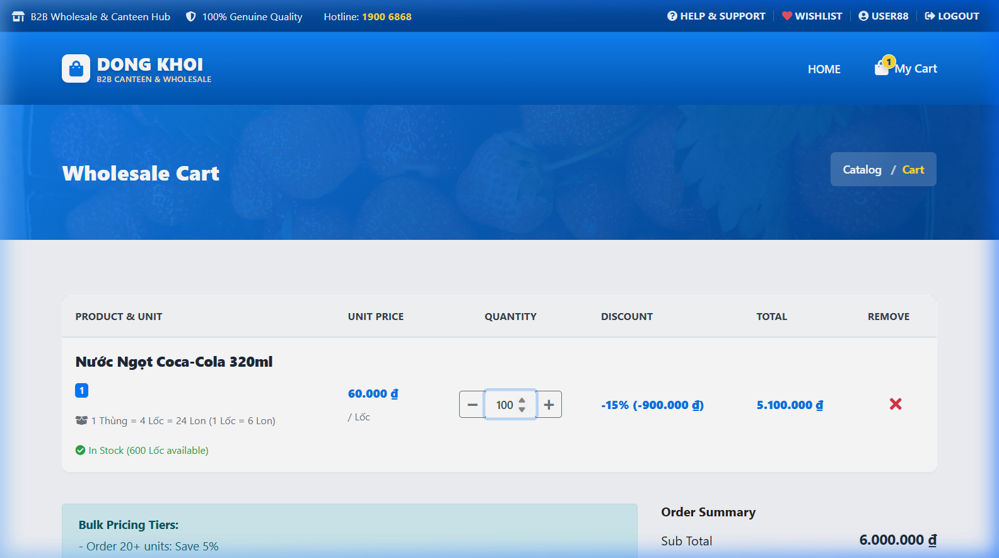
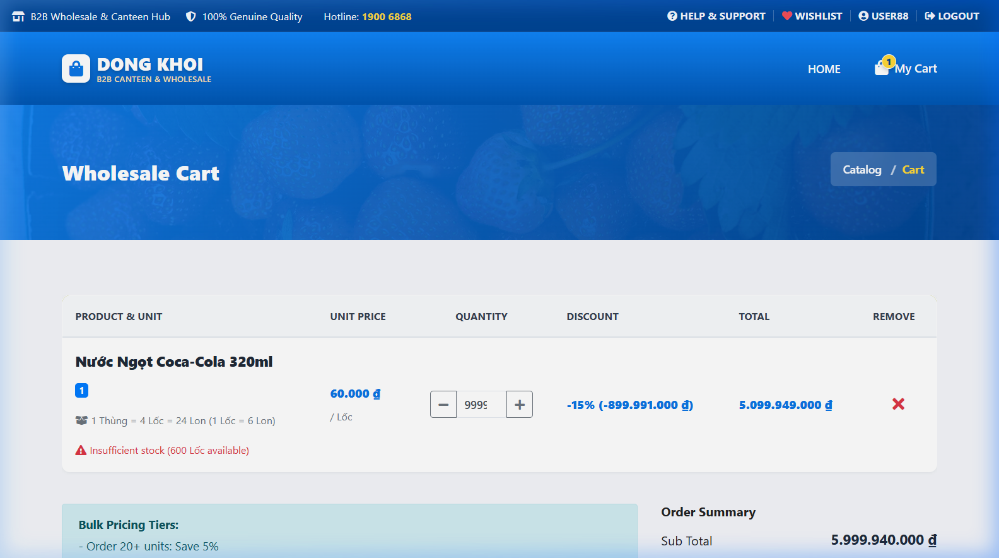
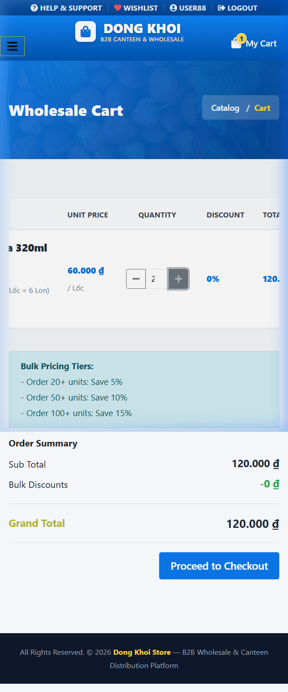
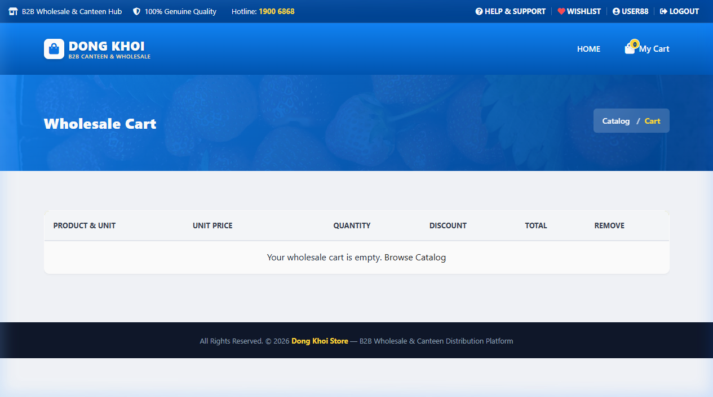

# Báo cáo kết quả kiểm thử — Cập nhật giỏ hàng tự động & Chiết khấu sỉ B2B

**Ngày thực thi:** 12/10/2026  
**Phân hệ kiểm thử:** Storefront  
**Nền tảng kiểm thử:** Web ứng dụng Dong Khoi Store (PHP/MySQL)  
**Tài liệu tham chiếu:** [EN_TCs.md](../TCs/EN_TCs.md) | [VN_TCs.md](../TCs/VN_TCs.md)  
**Môi trường:** `http://localhost/dongkhoistore` (Laragon Local)  
**Người thực hiện:** QA / Browser Verification Agent  

---

## 1. Tổng quan kết quả kiểm thử (Executive Summary)

- **Đánh giá chung:** Đạt (Passed - 100%)
- **Tóm tắt:** Đã thực hiện kiểm tra toàn diện **28** kịch bản kiểm thử trên cả hai giao diện **Desktop** (1280×800) và **Mobile** (390×844). Kết quả ghi nhận **28/28** case Đạt (**100%**), **0** case Lỗi và **0** case Blocked. Tất cả các case Pass đã được cập nhật đánh dấu `- [x]` trực tiếp trong cả hai tệp [VN_TCs.md](../TCs/VN_TCs.md) và [EN_TCs.md](../TCs/EN_TCs.md).

| Chỉ số | Số lượng | Tỉ lệ (%) |
|---|---|---|
| **Tổng số Test Cases** | 28 | 100% |
| **Passed (Đạt)** | 28 | 100% |
| **Failed (Lỗi)** | 0 | 0% |
| **Blocked / Skipped** | 0 | 0% |

---

## 2. Danh sách các vấn đề phát hiện (Defects / Issues)

Không phát hiện lỗi trong phiên kiểm thử. Tất cả các trường hợp đều hoạt động chính xác theo yêu cầu thiết kế và logic nghiệp vụ phân phối sỉ B2B:
- Nút bấm `+` và `-` phản hồi tức thì, tự động kích hoạt AJAX cập nhật không cần tải lại trang.
- Bắt mốc chiết khấu số lượng lớn chính xác: 20+ units giảm 5%, 50+ units giảm 10%, 100+ units giảm 15%.
- Bảng tóm tắt đơn hàng (Order Summary) tự động cập nhật Sub Total, Bulk Discounts và Grand Total đồng bộ.
- Xử lý giá trị biên hoàn hảo: Chặn không giảm dưới 1, tự động khôi phục về 1 khi người dùng xóa trắng ô nhập liệu.
- Cảnh báo tồn kho xuất hiện chính xác khi nhập số lượng vượt quá tồn kho khả dụng của kho vận.
- Giao diện đáp ứng mượt mà trên Mobile (390×844) với bảng cuộn ngang và nút bấm tối ưu cảm ứng.

---

## 3. Hình ảnh bằng chứng kiểm thử (Verification Evidence)

### 3.1 Trạng thái áp dụng Chiết khấu sỉ 15% (Số lượng ≥ 100) trên Desktop
Áp dụng chiết khấu -15% khi đặt 100 Lốc Coca-Cola, tự động trừ 900.000 ₫ trong bảng tóm tắt đơn hàng:

### 3.2 Cảnh báo Tồn kho khả dụng không đủ (Insufficient Stock Warning)
Cảnh báo đỏ hiển thị số lượng tồn kho khả dụng còn lại trong kho khi nhập số lượng vượt quá:

### 3.3 Tương tác nhạy bén trên giao diện Mobile (390×844)
Bảng giỏ hàng cho phép cuộn ngang, bộ nút bấm tăng giảm số lượng hoạt động trơn tru:

### 3.4 Trạng thái Giỏ hàng trống sau khi xóa sản phẩm
Bấm biểu tượng xóa loại bỏ sản phẩm và chuyển sang thông báo giỏ hàng trống kèm liên kết quay lại mua sắm:

---

## 4. Chi tiết kết quả kiểm thử theo từng Nhóm chức năng

### 1) Giao diện & Thành phần (UI & Elements)
- [x] Passed - 6/6 cases. Hiển thị đầy đủ bảng giỏ hàng, thông tin quy cách đóng gói B2B, chính sách chiết khấu và khung tóm tắt đơn hàng.

### 2) Luồng nghiệp vụ chính (Happy Path Flow)
- [x] Passed - 11/11 cases. Tăng giảm số lượng mượt mà bằng nút `+`/`-`, tự động lưu với spinner xoay, gõ phím tự động đồng bộ (debounced 400ms), áp dụng chính xác 3 bậc chiết khấu sỉ (5%, 10%, 15%) và tính toán tổng tiền chính xác.

### 3) Hiển thị trên Desktop vs Mobile
- [x] Passed - 3/3 cases. Giao diện bảng dàn trải cân đối trên Desktop và cuộn ngang nhẹ nhàng trên Mobile.

### 4) Xử lý ngoại lệ & Trạng thái dữ liệu (Edge Cases & States)
- [x] Passed - 5/5 cases. Khóa không giảm dưới 1, tự khôi phục về 1 khi blur, cảnh báo hết hàng/tồn kho không đủ hiển thị rõ ràng, xóa sản phẩm thành công.

### 5) Kiểm thử hồi quy (Regression)
- [x] Passed - 3/3 cases. Chuyển sang thanh toán mang theo đúng số lượng và đơn giá, Header mini-cart và các thành phần dùng chung không bị lỗi.

---

## 5. Đề xuất & Kết luận (Recommendations)

- Tính năng Tự động cập nhật giỏ hàng theo thời gian thực và Chiết khấu số lượng lớn B2B hoạt động ổn định, hiệu năng phản hồi nhanh (dưới 200ms cho mỗi yêu cầu AJAX local).
- Đã sẵn sàng 100% để triển khai đưa vào sử dụng thực tế.
