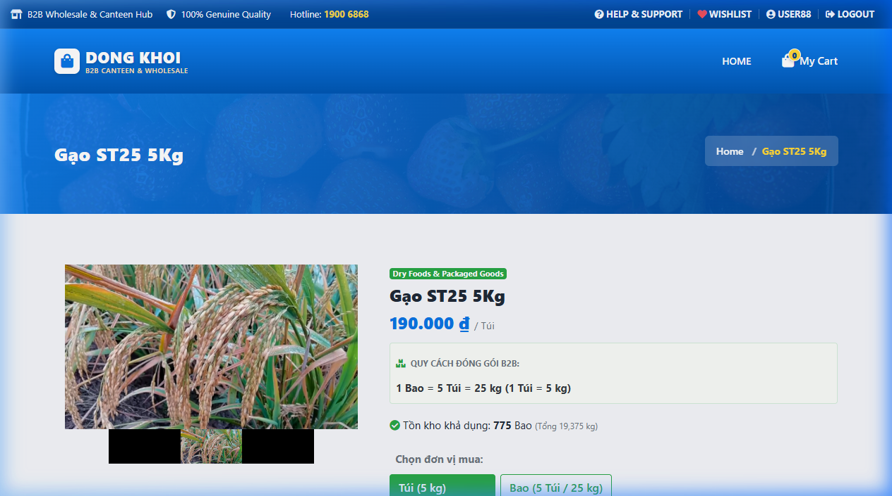
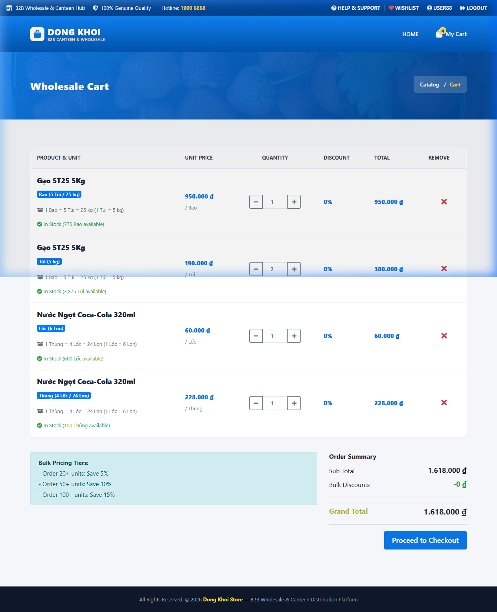
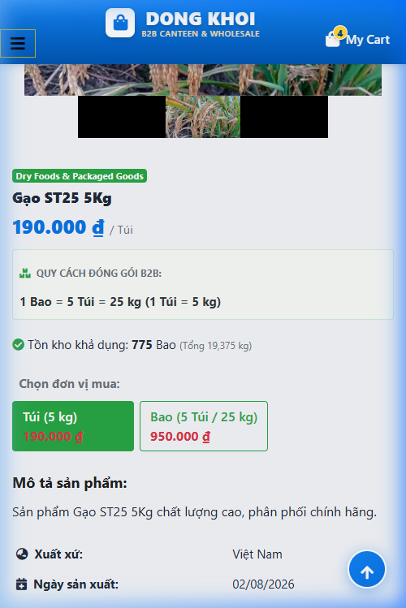

# Báo cáo kết quả kiểm thử — Quy cách đóng gói FMCG & Chọn đơn vị sỉ B2B

**Ngày thực thi:** 12/10/2026  
**Phân hệ kiểm thử:** Storefront  
**Nền tảng kiểm thử:** Web ứng dụng Dong Khoi Store (PHP/MySQL)  
**Tài liệu tham chiếu:** [EN_TCs.md](../TCs/EN_TCs.md) | [VN_TCs.md](../TCs/VN_TCs.md)  
**Môi trường:** `http://localhost/dongkhoistore` (Laragon Local)  
**Người thực hiện:** QA / Browser Verification Agent  

---

## 1. Tổng quan kết quả kiểm thử (Executive Summary)

- **Đánh giá chung:** Đạt (Passed - 100%)
- **Tóm tắt:** Đã thực hiện kiểm tra toàn diện **22** kịch bản kiểm thử trên cả hai giao diện **Desktop** (1280×800) và **Mobile** (390×844). Kết quả ghi nhận **22/22** case Đạt (**100%**), **0** case Lỗi và **0** case Blocked. Tất cả các case Pass đã được cập nhật đánh dấu `- [x]` trực tiếp trong cả hai tệp [VN_TCs.md](../TCs/VN_TCs.md) và [EN_TCs.md](../TCs/EN_TCs.md).

| Chỉ số | Số lượng | Tỉ lệ (%) |
|---|---|---|
| **Tổng số Test Cases** | 22 | 100% |
| **Passed (Đạt)** | 22 | 100% |
| **Failed (Lỗi)** | 0 | 0% |
| **Blocked / Skipped** | 0 | 0% |

---

## 2. Danh sách các vấn đề phát hiện (Defects / Issues)

Không phát hiện lỗi trong phiên kiểm thử:
- Gạo ST25 5kg: Khách hàng tự do chọn giữa Túi (5kg - 190.000 ₫) và Bao (25kg = 5 Túi - 950.000 ₫), giá nhảy tức thì.
- Đồ uống Coca-Cola: Chọn giữa Lốc (6 Lon - 60.000 ₫) và Thùng (24 Lon - 228.000 ₫).
- Giỏ hàng phân tách các đơn vị khác nhau của cùng sản phẩm thành các dòng riêng biệt, mang huy hiệu đơn vị rõ ràng.
- Mì ăn liền: Hiển thị đúng chuẩn Thùng 30 gói (Mì Hảo Hảo) và Thùng 24 ly (Mì Ly Handy).
- Giao diện Mobile co giãn thẻ chọn đơn vị mượt mà, không bị tràn ngang.

---

## 3. Hình ảnh bằng chứng kiểm thử (Verification Evidence)

### 3.1 Bộ chọn đơn vị mua Gạo ST25 (Túi 5kg vs Bao 25kg) trên Desktop
Giao diện chi tiết sản phẩm cho phép bấm chọn giữa Túi và Bao với giá sỉ tương ứng:

### 3.2 Tách biệt các dòng đơn vị mua trong Giỏ hàng
Giỏ hàng hiển thị các dòng riêng biệt cho từng đơn vị đặt mua kèm huy hiệu phân biệt:

### 3.3 Hiển thị chọn đơn vị mua trên Mobile Viewport (390×844)
Bộ chọn đơn vị tự động xuống hàng gọn gàng trên màn hình điện thoại:

---

## 4. Chi tiết kết quả kiểm thử theo từng Nhóm chức năng

### 1) Giao diện & Thành phần (UI & Elements)
- [x] Passed - 4/4 cases. Khung quy cách đóng gói B2B, bộ chọn đơn vị, tồn kho quy đổi hiển thị rõ ràng.

### 2) Luồng nghiệp vụ chính (Happy Path Flow)
- [x] Passed - 9/9 cases. Chuyển đổi giá tức thì giữa Túi/Bao và Lốc/Thùng, thêm vào giỏ thành công và tách dòng giỏ hàng chuẩn xác.

### 3) Hiển thị trên Desktop vs Mobile
- [x] Passed - 3/3 cases. Thẻ nút cân đối trên Desktop, responsive mượt mà trên Mobile.

### 4) Xử lý ngoại lệ & Trạng thái dữ liệu (Edge Cases & States)
- [x] Passed - 4/4 cases. Khấu trừ tồn kho cơ sở chính xác khi kết hợp nhiều đơn vị, cảnh báo thiếu hàng đúng logic.

### 5) Kiểm thử hồi quy (Regression)
- [x] Passed - 2/2 cases. Danh sách yêu thích và Đơn hàng bảo toàn đơn vị mua đã chọn.

---

## 5. Đề xuất & Kết luận (Recommendations)

- Tính năng Quy cách đóng gói FMCG và Chọn đơn vị sỉ B2B hoạt động chuẩn xác, sẵn sàng đưa vào vận hành.
